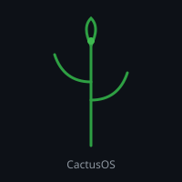

# CactusOS



Experimental operating system research project combining a **no_std Rust kernel library** (HyperOS) with a **Python cognitive core** that routes to Gemini or local Ollama.

> **Status:** Research / experimental. Not a production OS.

## Features

- **HyperOS** — bare-metal optional Rust crate (`no_std`, no heap) with scheduler, chrono log, agent bridge, Ollama client stubs
- **Cognitive core** (`si_1_core`) — intent NLP, safety filter, provider router
- **Gemini primary** → **Ollama fallback** (recommended model: `llama3.2:3b` on 16 GB RAM)
- **Matrix tile engine** — compact infinity mapping and streaming tiles for low RAM/CPU
- **SVL kernel** — topological infinity metric and protected config pattern
- **File transfer** — local upload endpoint (`uploads/`)
- Explicit approval required for any command execution

## Quick Start

```bash
git clone https://github.com/marcinwietrzala-stack/CactusOS.git
cd CactusOS
cp .env.example .env
# Add your GEMINI_API_KEY to .env

# Optional: set up local Ollama fallback
bash scripts/ollama_16gb.sh

# Status
python3 -m si_1_core.svl_kernel
python3 -m si_1_core.status_cli
```

## Provider Configuration

| Priority | Provider | Requirement |
|----------|----------|-------------|
| 1 | Gemini | `GEMINI_API_KEY` |
| 2 | Ollama | Local Ollama + model |

See [.env.example](.env.example).

## Project Layout

```
CactusOS/
├── src/                 # HyperOS Rust (no_std)
├── hyperos/             # Python integration helpers
├── si_1_core/           # Cognitive engine, NLP, providers, SVL
├── scripts/             # ollama_16gb.sh, file_transfer.sh
├── docs/                # Additional documentation
├── assets/              # Logo and graphics
├── Modelfile            # Ollama model definition
└── LICENSE
```

## Documentation

- [Overview](docs/OVERVIEW.md)
- [Ollama 16 GB setup](si_1_core/ollama_16gb.md)
- [File transfer](si_1_core/file_transfer.md)
- [Completion notes](si_1_core/COMPLETION.md)

## Safety Notes

- Commands require explicit user approval.
- No automatic root or background privileged agents.
- Do not commit API keys. Use `.env` (gitignored).
- The fictional ship "Mateusz_1" and similar lore have no real telemetry.

## License

[MIT](LICENSE) © 2026 Mateusz Mitek

---

*Built for experimentation. Contributions welcome.*
